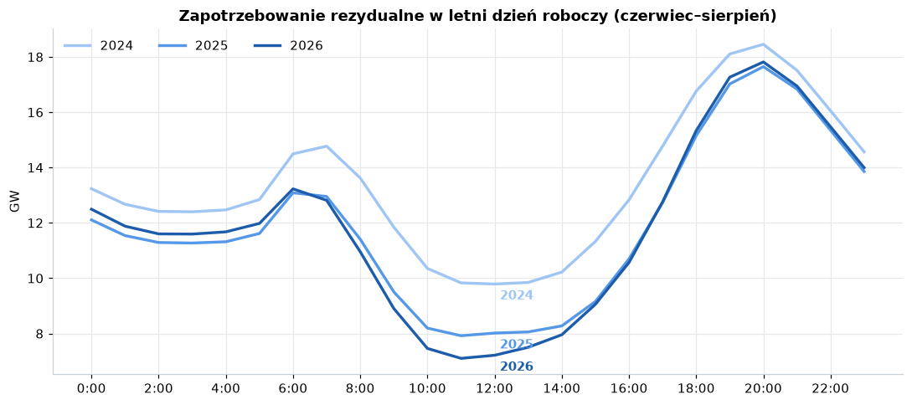
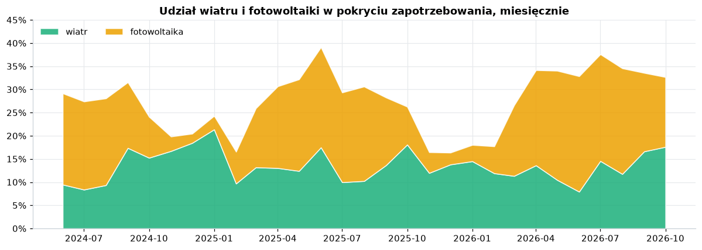
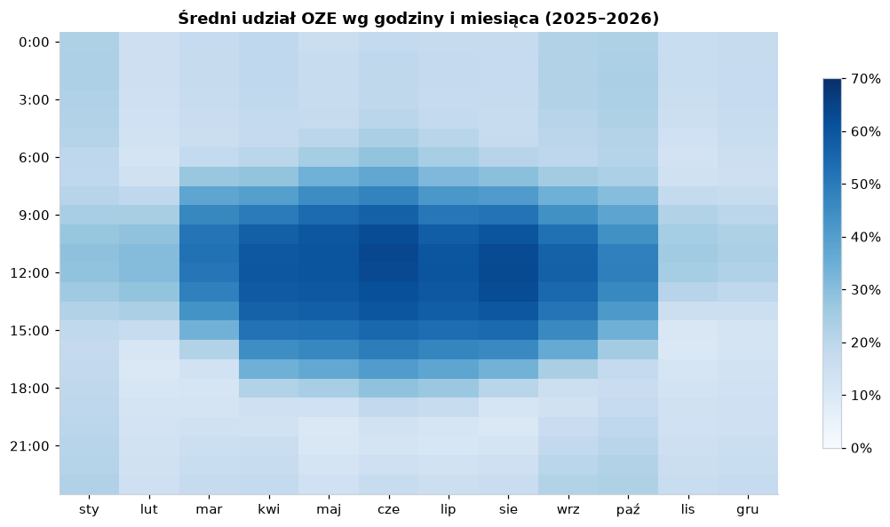
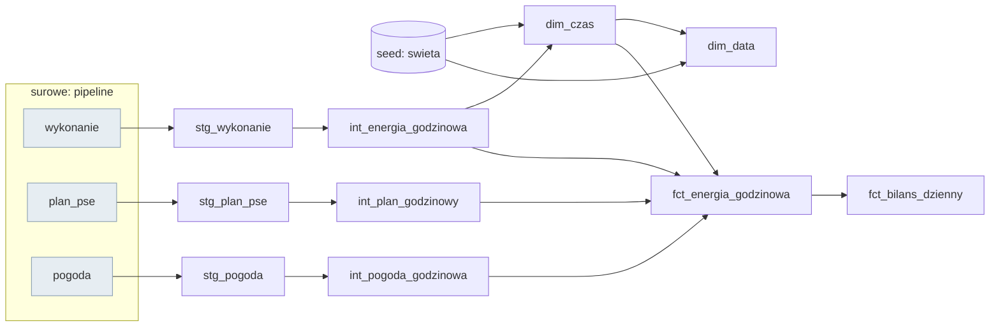

# Prognozowanie polskiego systemu energetycznego

Czy da sie prognozowac zapotrzebowanie na energie oraz generacje z wiatru i fotowoltaiki
na dobe naprzod dokladniej niz oficjalny plan operatora (PSE)?

Projekt end-to-end: pipeline danych -> hurtownia -> analiza (Power BI) -> model ML -> wdrozenie.

> Status: **etapy 1–8 gotowe**, codzienna prognoza dziala; uczciwe porownanie z PSE zbiera dane (86 testow w Pythonie, 29 testow jakosci danych w dbt)

## Dane
- [API PSE](https://api.raporty.pse.pl) — wykonanie KSE (co 15 min), plany koordynacyjne
- [Open-Meteo](https://open-meteo.com) — historyczne prognozy pogody

## Najwazniejsze odkrycia
- Czas lokalny w danych PSE jest niejednoznaczny przy zmianie czasu (`02a:15`, doby 92/100 kwadransow) -> pracujemy w UTC
- Plan PSE dostepny w API jest **nadpisywany do konca doby**, wiec nie jest uczciwym benchmarkiem
  prognozy dobowej -> pipeline archiwizuje kazda publikacje
- Model musi korzystac z **prognoz** pogody, nie z pogody faktycznej (unikamy wycieku danych)
- PSE poprawia dane wykonawcze nawet po kilku miesiacach -> kazde ladowanie odswieza okno ostatnich dob

Szczegoly: [notebook eksploracyjny](notebooks/01_eksploracja.ipynb), [architektura](docs/architektura.md).

## Uruchomienie
```bash
uv sync
uv run python -m energia.pipeline   # pobiera brakujace dane i przebudowuje hurtownie (dbt build)
uv run streamlit run app/app.py     # aplikacja (strony: Bilans, Analiza, Prognoza)
uv run python -m energia.eksport    # dane dla Power BI -> powerbi/dane/*.parquet
uv run python -m energia.model.trening   # backtest + modele (ok. 14 min)
uv run python -m energia.model.prognoza  # prognoza na jutro (robi ja tez pipeline)
uv run pytest                       # testy
```

## Pipeline (etap 2)
| modul | rola |
|---|---|
| `energia/http.py` | GET z ponawianiem (4 proby, backoff 1/2/4 s; 4xx bez ponawiania) |
| `energia/pse.py` | API PSE: paginacja po `nextLink`, klucz czasu UTC, wykrywanie duplikatow |
| `energia/pogoda.py` | historyczne **prognozy** pogody (Open-Meteo) dla 5 punktow |
| `energia/ladowanie.py` | okno ladowania inkrementalnego z 3-dniowym oknem korekt |
| `energia/magazyn.py` | DuckDB: upsert pomiarow, archiwum **kazdej wersji** planu PSE, log uruchomien |
| `energia/pipeline.py` | sklada calosc; idempotentny (ponowne uruchomienie nie dubluje danych) |

## Model (etapy 5–6)

LightGBM prognozuje **zapotrzebowanie, wiatr i PV na kazda godzine doby D, liczac w D-1**: cechy siegaja
najwyzej 48 h wstecz (ta sama godzina w D-2), plus prognoza pogody i kalendarz. Wiatr i PV jako ulamek
maksimum z 30 dni (drzewa nie ekstrapoluja, a moc zainstalowana rosnie). Trzy kwantyle (10/50/90%),
przedzial 80% kalibrowany konformalnie.

Backtest z rosnacym oknem, 12 miesiecy (11.2025–10.2026), nMAE = sredni blad / srednia wartosc:

| cel | model | prognoza naiwna | plan PSE (wersja ostatnia)* | w przedziale 80% (przed → po kalibracji) |
|---|---|---|---|---|
| zapotrzebowanie | **2,8%** | 5,8% | 1,4% | 51% → 90% |
| wiatr | **19,0%** | 69,3% | 6,5% | 60% → 83% |
| PV | **11,8%** | 26,7% | 6,0% | 70% → 73% |

\* Wersja ostatnia planu PSE jest poprawiana w trakcie doby (zna czesc przyszlosci), wiec nie jest
uczciwym benchmarkiem. Uczciwe porownanie, **prognoza modelu i plan PSE, oba sprzed doby**, zbiera sie
codziennie w `fct_ocena_prognoz` od 10.2026.

Zastrzezenie: w treningu pogoda to archiwalne prognozy o krotkim horyzoncie, wiec w produkcji (prognoza
pogody na nastepny dzien) blad bedzie nieco wiekszy. Mierzy to wlasnie porownanie na zywo.

## Automatyzacja (etap 7)

- `.github/workflows/testy.yml`: pytest + `dbt parse` przy kazdym pushu
- `.github/workflows/codziennie.yml`: codziennie 8:00 UTC pobranie danych → `dbt build` z testami →
  prognoza na jutro; w poniedzialki ponowny trening. Baza i modele miedzy uruchomieniami jako zalaczniki
  wydania `dane`.
- MLflow: kazdy trening zapisuje parametry i metryki backtestu (`uv run mlflow ui --backend-store-uri sqlite:///data/mlflow.db`)

## Co pokazuja dane (etap 4)

| | 2024 | 2025 | 2026 |
|---|---|---|---|
| Udzial wiatru i PV w zapotrzebowaniu (lip–wrz) | 29,0% | 29,4% | **35,2%** |
| Godziny z OZE > 50% (cze–wrz) | 420 | 650 | **804** |
| Zapotrzebowanie rezydualne w letnie poludnie | 9,8 GW | 8,0 GW | **7,3 GW** |
| Rampa poludnie -> 20:00 (letni dzien roboczy) | 8,5 GW | 9,3 GW | **10,3 GW** |



- Zaleznosc popytu od temperatury ma ksztalt U (minimum ~18–20°C, mroz: +32%); sobota −11%, niedziela/swieto −19%.
- Najnizsze zapotrzebowanie rezydualne: **Wielkanoc 2026, 11:00 — 2,5 GW** (PV 9,4 GW przy popycie 12,9 GW).
- Srednia z kilku punktow pogodowych tlumaczy generacje lepiej niz pojedynczy punkt (wiatr 0,90, PV 0,96).

Pelna analiza: [notebooks/02_analiza.ipynb](notebooks/02_analiza.ipynb) · aplikacja, strona *Analiza* ·
paczka Power BI (dane Parquet, miary DAX, motywy, instrukcja): [powerbi/](powerbi/INSTRUKCJA.md)

<p>


</p>

## Hurtownia (etap 3, dbt)



- **staging**: nazwy, jednostki, poczatek/koniec kwadransa; promieniowanie przesuniete o godzine
  (Open-Meteo podaje srednia z godziny poprzedzajacej: korelacja z PV 0,919 -> 0,964)
- **intermediate**: kwadranse -> godziny; plan PSE w dwoch wersjach: *ostatni* i *znany dzien przed*
  (point-in-time); pogoda z 5 punktow w jednym wierszu
- **marts**: `fct_energia_godzinowa` (model ML, Power BI), `fct_bilans_dzienny`, `dim_czas`
  (godziny UTC, atrybuty w czasie polskim, swieta), `dim_data` (dla Power BI)
- **testy**: unikalnosc kluczy, zakresy wartosci (wlasny test `w_zakresie`), brak dziur godzinowych,
  doby po 23/24/25 godzin przy zmianie czasu, spojnosc bilansu

```bash
cd dbt && uv run dbt build          # modele + testy
uv run dbt docs generate && uv run dbt docs serve   # dokumentacja z grafem zaleznosci
```

## Stack
Python 3.13, uv, httpx, pandas, DuckDB, dbt, LightGBM, MLflow, pytest, Streamlit, Altair, GitHub Actions, Power BI
