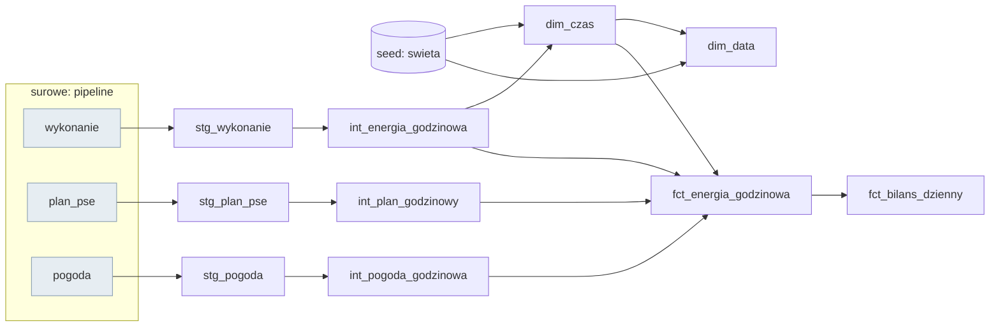

# Prognozowanie polskiego systemu energetycznego

Czy da sie prognozowac zapotrzebowanie na energie oraz generacje z wiatru i fotowoltaiki
na dobe naprzod dokladniej niz oficjalny plan operatora (PSE)?

Projekt end-to-end: pipeline danych -> hurtownia -> analiza (Power BI) -> model ML -> wdrozenie.

> Status: **etap 3 / 8 — hurtownia dbt gotowa** (48 testow w Pythonie, 27 testow jakosci danych w dbt)

## Dane
- [API PSE](https://api.raporty.pse.pl) — wykonanie KSE (co 15 min), plany koordynacyjne
- [Open-Meteo](https://open-meteo.com) — historyczne prognozy pogody

## Najwazniejsze odkrycia
- Czas lokalny w danych PSE jest niejednoznaczny przy zmianie czasu (`02a:15`, doby 92/100 kwadransow) -> pracujemy w UTC
- Plan PSE dostepny w API jest **nadpisywany do konca doby**, wiec nie jest uczciwym benchmarkiem
  prognozy dobowej -> pipeline archiwizuje kazda publikacje
- Model musi korzystac z **prognoz** pogody, nie z pogody faktycznej (unikamy wycieku danych)
- PSE poprawia dane wykonawcze nawet po kilku miesiacach -> kazde ladowanie odswieza okno ostatnich dob

Szczegoly: [notebook eksploracyjny](notebooks/01_eksploracja.ipynb), [architektura](docs/architektura.md).

## Uruchomienie
```bash
uv sync
uv run python -m energia.pipeline   # pobiera brakujace dane i przebudowuje hurtownie (dbt build)
uv run streamlit run app/app.py     # aplikacja
uv run pytest                       # testy
```

## Pipeline (etap 2)
| modul | rola |
|---|---|
| `energia/http.py` | GET z ponawianiem (4 proby, backoff 1/2/4 s; 4xx bez ponawiania) |
| `energia/pse.py` | API PSE: paginacja po `nextLink`, klucz czasu UTC, wykrywanie duplikatow |
| `energia/pogoda.py` | historyczne **prognozy** pogody (Open-Meteo) dla 5 punktow |
| `energia/ladowanie.py` | okno ladowania inkrementalnego z 3-dniowym oknem korekt |
| `energia/magazyn.py` | DuckDB: upsert pomiarow, archiwum **kazdej wersji** planu PSE, log uruchomien |
| `energia/pipeline.py` | sklada calosc; idempotentny (ponowne uruchomienie nie dubluje danych) |

## Hurtownia (etap 3, dbt)



- **staging**: nazwy, jednostki, poczatek/koniec kwadransa; promieniowanie przesuniete o godzine
  (Open-Meteo podaje srednia z godziny poprzedzajacej: korelacja z PV 0,919 -> 0,964)
- **intermediate**: kwadranse -> godziny; plan PSE w dwoch wersjach: *ostatni* i *znany dzien przed*
  (point-in-time); pogoda z 5 punktow w jednym wierszu
- **marts**: `fct_energia_godzinowa` (model ML, Power BI), `fct_bilans_dzienny`, `dim_czas`
  (godziny UTC, atrybuty w czasie polskim, swieta), `dim_data` (dla Power BI)
- **testy**: unikalnosc kluczy, zakresy wartosci (wlasny test `w_zakresie`), brak dziur godzinowych,
  doby po 23/24/25 godzin przy zmianie czasu, spojnosc bilansu

```bash
cd dbt && uv run dbt build          # modele + testy
uv run dbt docs generate && uv run dbt docs serve   # dokumentacja z grafem zaleznosci
```

## Stack
Python 3.13, uv, httpx, pandas, DuckDB, dbt, pytest, Streamlit, Altair · (wkrotce) LightGBM, MLflow, GitHub Actions
